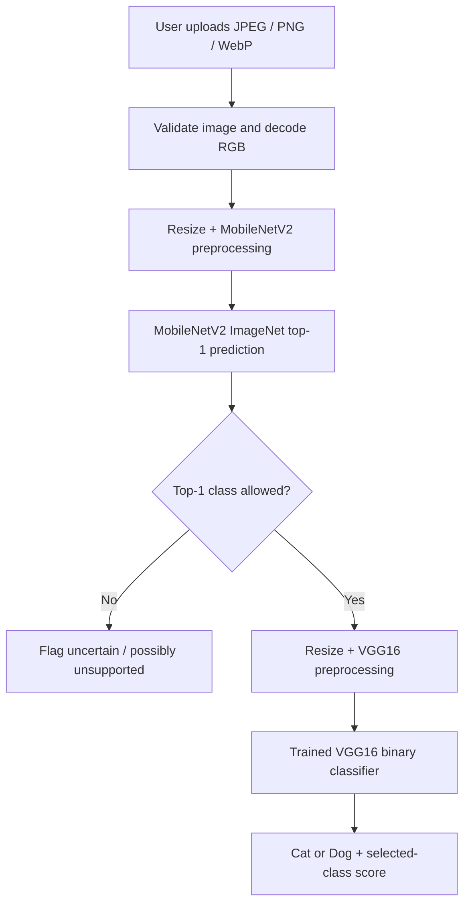

# 🐾 Cats vs. Dogs V3 — Two-Stage Image Classification

**Transfer learning · ImageNet input screening · Model robustness · Streamlit deployment**

[](https://cats-dogs-v3-experimental.streamlit.app/)
[](https://cats-dogs-vgg16-demo.streamlit.app/)
[](https://www.python.org/)

> **Experimental portfolio project, not a production-grade animal detector.** V3 attempts to screen out unsupported images before running a binary cat/dog classifier. Its decisions are fallible: it may reject a real cat/dog or accept an unsupported image. A high model score is not a calibrated guarantee.

## 🎯 Why this project exists

The first version of this project used **VGG16 transfer learning** to classify photographs as either a cat or a dog. It worked on normal examples, but a lion photo was confidently labeled **Dog (100%)**. That exposed a fundamental limitation of a closed-set binary classifier: it must choose one of its two labels, even when neither is appropriate.

Rather than only changing the UI, I investigated the model's behavior on out-of-scope images, audited mislabeled test data, and built a **two-stage experimental system**:

1. **MobileNetV2 input gate** checks the top predicted ImageNet class. If it is not one of the configured domestic cat/dog categories, the app flags the image as **uncertain / possibly unsupported**.
2. **VGG16 binary classifier** runs only if the gate accepts the image, then predicts **Cat** or **Dog**.

The gate is a **top-1 class-list heuristic, not a validated general out-of-distribution (OOD) detector**.

## 🔗 Try it

- **[V3 — experimental two-model demo](https://cats-dogs-v3-experimental.streamlit.app/)** — upload a cat, dog, or unexpected image to see the gate's decision.
- **[V2 — original classifier demo](https://cats-dogs-vgg16-demo.streamlit.app/)** — compare the behavior of the binary-only application.

Both applications are hosted on **Streamlit Community Cloud**. The first V3 inference may take longer because pretrained MobileNetV2 weights and the ImageNet class index may need to be downloaded.

## 🏗️ Architecture



### Model responsibilities

| Component | Role | Details |
|---|---|---|
| **MobileNetV2** | Preliminary input screening | ImageNet-pretrained classifier; checks whether the **top-1 ImageNet class ID** belongs to a small list of domestic-cat classes or the domestic-dog class range. No detector-specific fine-tuning was performed. |
| **VGG16** | Cat/dog prediction | Frozen ImageNet-pretrained backbone → `Flatten` → `Dropout(0.3)` → `Dense(1, sigmoid)`. |
| **Streamlit** | UI and inference orchestration | Image upload, input validation, cached model loading, screening result, class scores and explicit warnings. |

The models use **different `preprocess_input` functions**. Both start from an RGB image resized to **224 × 224**; VGG16 preprocessing does **not** divide pixels by 255. The VGG16 sigmoid uses **cat = 0, dog = 1**. An accepted image can still be misclassified.

## 🧪 Model training

The training/export notebook uses **TensorFlow Datasets `cats_vs_dogs`**:

| Training setup | Value |
|---|---|
| Sampled dataset | 1,500 cats + 1,500 dogs (3,000 images) |
| Train / validation / test | 2,100 / 450 / 450 (70% / 15% / 15%) |
| Input resolution | 224 × 224 |
| Base network | VGG16, ImageNet weights, frozen backbone |
| Head | Flatten → Dropout(0.3) → sigmoid |
| Optimizer | Adam, learning rate `1e-3` |
| Loss | Binary cross-entropy |
| Epochs / batch size | 8 / 32 |
| Saved model | `models/cats_dogs_vgg16.keras` |

The export notebook also generates `test_metrics.json` with test accuracy, classification report and a confusion matrix. **Its actual numeric scores are not reproduced here**, since the corresponding metrics file was not included with the reviewed material. The results below are from a **separate small robustness holdout**, not from the original 450-image notebook test split.

## 📊 V3 holdout evaluation

The final local holdout included **37 visually reviewed images**, kept separate from the earlier detector-development set. The V3 screening rules were not changed while scoring this holdout. Images were excluded for label/suitability reasons **before** model scoring. This was a small practical check, not a statistically comprehensive benchmark.

### Summary

| Metric | Result |
|---|---:|
| Total holdout images processed | **37 / 37** |
| Valid cat/dog images accepted by MobileNetV2 | **16 / 18 = 88.9%** |
| Valid cat/dog images incorrectly rejected | **2 / 18 = 11.1%** |
| Unsupported images rejected | **19 / 19 = 100%** |
| Correct end-to-end cat/dog outcomes (accept + classify correctly) | **13 / 18 = 72.2%** |
| Correct decisions over all three outcome groups on this sample | **32 / 37 = 86.5%** |
| Original VGG16 accuracy on 18 cat/dog images without the gate | **15 / 18 = 83.3%** |

**What counted as unsupported:** 9 lion images and 10 images of birds/plants. **No confirmed wolf photos were present in this holdout**; wolf rejection performance was therefore **not evaluated** here.

### End-to-end outcome matrix

Rows are the visually reviewed ground-truth categories; columns are V3's final displayed outcomes:

| Actual image | Predicted Cat | Predicted Dog | Flagged / rejected |
|---|---:|---:|---:|
| Cat (9) | **5** | 3 | 1 |
| Dog (9) | 0 | **8** | 1 |
| Unsupported (19) | 0 | 0 | **19** |

**Interpretation:** V3 avoided forced Cat/Dog labels on all 19 unsupported holdout images, but it also blocked two valid animals and misclassified three accepted cats. The gate **improved handling of these unsupported examples**, while **reducing successful cat/dog outcomes** relative to using VGG16 alone on this particular sample.

### Why raw confidence was not enough

During the same holdout evaluation, the original binary VGG16 classifier assigned **≥99% selected-class scores to 18 of 19 unsupported images**. High sigmoid scores therefore did not establish that an image contained a supported animal.

> **Limitations of these numbers:** The sample is small and uneven, the earlier development set contained mislabeled images, and a single holdout does not establish real-world reliability. Do not interpret the 19/19 rejection result as a guaranteed 100% OOD detection rate.

## 🔁 Project evolution

| Version | Behavior | Engineering lesson |
|---|---|---|
| **V1** | VGG16 predicts Cat or Dog for any decodable image | Closed-set models cannot inherently recognize unknown inputs |
| **V2** | Adds clear supported-input and confidence limitations | UI transparency matters, but does not solve detection |
| **V3** | Adds a MobileNetV2 screening gate ahead of VGG16 | Multi-model inference introduces a rejection/acceptance tradeoff that requires independent evaluation |

## 💻 Run locally

**Recommended:** Python **3.11**. The project's cloud dependency pin, `tensorflow-cpu==2.20.0`, did not install under Python 3.14 during deployment, so Streamlit Cloud was configured with Python 3.11.

```bash
git clone https://github.com/XenosPro/cats-dogs-vgg16-demo.git
cd cats-dogs-vgg16-demo
python -m venv .venv
```

Activate the environment:

```powershell
# Windows PowerShell
.\.venv\Scripts\Activate.ps1
```

Install dependencies and launch either app:

```bash
python -m pip install -r requirements.txt
python -m streamlit run app_v3_demo.py
# or: python -m streamlit run app.py
```

The exported full Keras model must exist at **`models/cats_dogs_vgg16.keras`**. If it is missing, run the provided training/export notebook, then place the trained model in that path. V3 also needs network access on first run to obtain the MobileNetV2 ImageNet weights/class index if not cached.

## 📁 Important files

```text
cats-dogs-vgg16-demo/
├── app.py                        # V2 binary-classifier app
├── app_v3_preview.py             # Local experimental V3 prototype
├── app_v3_demo.py                # Public experimental V3 app
├── evaluate_robustness.py        # Binary classifier evaluation helper
├── export_vgg_kaggle_fixed.ipynb # Training and export notebook
├── requirements.txt
└── models/
    └── cats_dogs_vgg16.keras     # Trained full Keras model (required)
```

Additional development utilities, downloaded photos, contact sheets and evaluation CSVs were used locally during experimentation; **not all are committed to the public repository**. Do not assume the small holdout can be exactly reproduced from this repository alone. If publishing evaluation images later, review the individual photo licenses and required credits first.

## 🛡️ Input handling and limitations

- Accepts **JPEG, PNG and WebP**; caps uploads at **10 MB** and **32 megapixels**, with large images reduced before inference.
- Uses cached model resources to avoid reloading weights on every Streamlit rerun.
- A top-1 MobileNetV2 label outside the allowed list produces **“uncertain / possibly unsupported”**, not proof of the actual animal or object.
- The ImageNet class-list approach is **not a calibrated OOD detector** and does not reliably handle all wolves, wild cats, unusual camera angles, sketches or images with multiple subjects.
- VGG16's sigmoid class score is **not a calibrated correctness probability**, even when shown as 100.0% after rounding.
- The app is an **educational portfolio demo**, not an animal identification or safety-critical service. It does not intentionally retain user uploads.

## 🚧 Future improvements

- Test on larger, independently labeled, representative datasets, including confirmed wolves and harder cat/dog examples.
- Explore top-k evidence, feature-space distance or a separately trained rejection model; select thresholds on a validation set and assess a new untouched test set.
- Add automated regression tests, inference latency/memory measurements and deployment monitoring.
- Export reproducible evaluation reports with dataset provenance and relevant licenses.

---

**Repository:** [XenosPro/cats-dogs-vgg16-demo](https://github.com/XenosPro/cats-dogs-vgg16-demo)  
**Live experimental app:** [cats-dogs-v3-experimental.streamlit.app](https://cats-dogs-v3-experimental.streamlit.app/)
